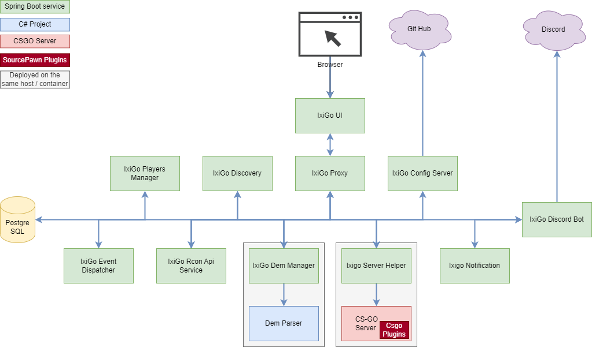
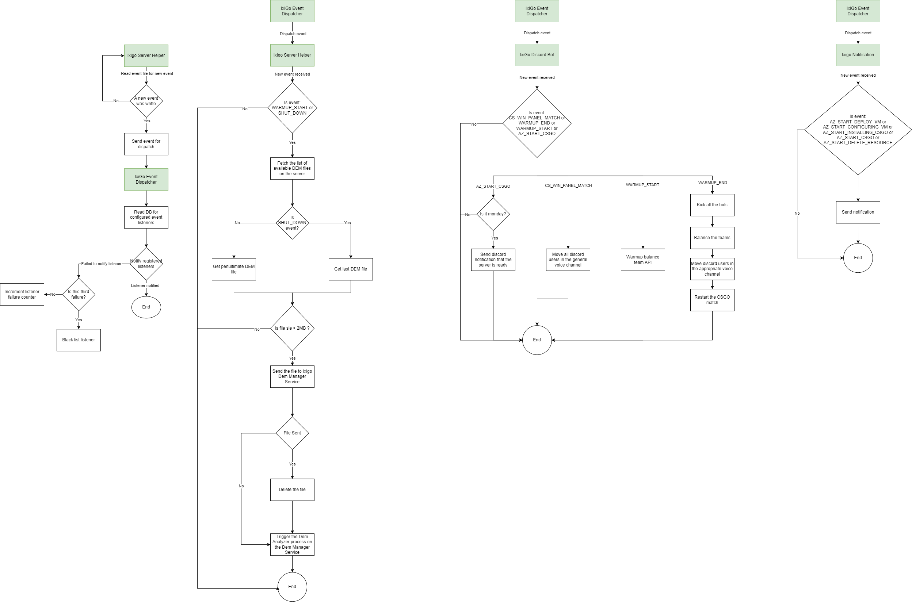

# IxiGo Util

## :warning: **This project is still in development.** :warning:

This project was created 4 years ago for CSGO servers. With CS2 few things have changed, so I'm updating the project to work with the new version of the game.


This is a personal project that I made to simplify few things that I do when playing with my friends at CSGO. I have created a custom CSGO [dedicated server](https://github.com/marcosolina/ixi_go) that we use every week and we wanted to enhance our gaming experience with the automation of few tasks, like changing the map, add or remove bots, analyse our game performance and generate balanced teams based on our performance.

## Technologies Utilised

|                                               |                                                          |                                                                      |
| --------------------------------------------- | -------------------------------------------------------- | -------------------------------------------------------------------- |
| [Java](https://www.oracle.com/java/)          | [Spring Boot](https://spring.io/projects/spring-boot)    | [Spring Cloud](https://spring.io/projects/spring-cloud)              |
| [React](https://react.dev/)                   | [HTML](https://en.wikipedia.org/wiki/HTML)               | [Javascript](https://en.wikipedia.org/wiki/JavaScript)               |
| [TypeScript](https://www.typescriptlang.org/) | [Material UI](https://mui.com/)                          | [Docker](https://www.docker.com/)                                    |
| [PostgreSQL](https://www.postgresql.org/)     | [JPA](https://en.wikipedia.org/wiki/Jakarta_Persistence) | [C#](<https://en.wikipedia.org/wiki/C_Sharp_(programming_language)>) |
| And others                                    |                                                          |                                                                      |

## Requirements

- Docker with Docker Compose, to run the services
- Java 11 and Maven, Node.js and .NET, only to build without Docker (the code does not compile on a much newer JDK)
- [IxiGo Dedicated Server](https://github.com/marcosolina/ixi_go)
- [Discord Bot Token](./services/IxigoDiscordBot/)
- [Steam Game Server Login Token](http://steamcommunity.com/dev/managegameservers)
- [Steam API Key](http://steamcommunity.com/dev/apikey)

## Project Structure



- csgo_util
  - `pom.xml`: Maven aggregator that builds every Java module in the right order (`mvn -B package`)
  - **libs**: shared Java code
    - [IxigoParent](./libs/IxigoParent/): parent POM of the business services
    - [IxigoLibrary](./libs/IxigoLibrary/): shared Spring components (request mediator, DAO base classes, web client, validators)
    - `Ixigo*Contract`: the REST models of each service, shared with the services that call it
  - **services**: the Spring Boot services
    - [IxigoConfigServer](./services/IxigoConfigServer/): This is the Spring Boot configuration service that is used to serve the Services Properties for the different environmnets. The properties live in the [csgo_props](https://github.com/marcosolina/csgo_props) repository
    - [IxigoDemManager](./services/IxigoDemManager): This Spring Boot service manages the "dem" files created by the CSGO server. For example it will store new files, use the parsers to process these files, expose REST API to retrieve the info or the files itself
    - [IxigoDiscordBot](./services/IxigoDiscordBot/): This Spring Boot service is used to automate some taks while we play on our CSGO dedicated server. For example it will listen for either CSGO events or messages in the chat and then it can move the players to the appropriate channel, retrieve the Players statistic to balance the teams. Type "!help" in the discord chat to see a full list of tasks that you can trigger
    - [IxigoDiscovery](./services/IxigoDiscovery/): This Spring Boot service is used to register all the services and simplify the S2S calls. It can be usefull for load balancing, either client side or server side load balancing
    - [IxigoEventDispatcher](./services/IxigoEventDispatcher/): This Spring Boot service receives the event fired by the Ixigo Server Helper and forwards these events to all the registered event listeners
    - [IxigoNotification](./services/IxigoNotification/): This Spring Boot service it is used to send notifications, for example via Telegram
    - [IxigoPlayersManager](./services/IxigoPlayersManager/): This Spring Boot service uses the players stats to perform some calculation. For example, this service is used to generate balanced CSGO teams when we play on our CSGO dedicated server
    - [IxigoProxy](./services/IxigoProxy/): This Spring Boot service is a proxy service that it is used to simplify the S2S calls. It is usesfull to perform the service side load balancing and to have a central point to call all the services. It can also help when you have CORS issues
    - [IxigoRconApi](./services/IxigoRconApi/): This Spring Boot service it is used to send RCON commands to our CSGO dedicated server via REST APIs
    - [IxigoServerHelper](./services/IxigoServerHelper/): This Spring Boot service is deployed on the same machine where the CSGO server is running. It monitors some CSGO files, fires events to the Ixigo Event Dispatcher and uploads the DEM files to the DEM manager service
    - [IxigoUi](./services/IxigoUi/): This Spring Boot Service it is used to provide a simple UI that can be used to perform some tasks when we play on our CSGO dedicate server. For example it can be used to quickly change the map, add / remove bot and balance the teams
  - **parsers**: the ".dem" parsers that the DEM manager runs
    - [DemoParserCS2](./parsers/DemoParserCS2/): CS2 demos
    - [DemParserNodeJs](./parsers/DemParserNodeJs/): CSGO demos (still needed to re-parse the old games)
  - **plugins**: [IxigoPlugin](./plugins/IxigoPlugin/), the CS2 server plugin (CounterStrikeSharp) that exports the game events
  - **tools**: [IxigoIntegrationTests](./tools/IxigoIntegrationTests/) (Cucumber) and [IxigoUtils](./tools/IxigoUtils/) (DAO/DTO generator)
  - **legacy**: kept for reference, not built: the C# [DemParser](./legacy/DemParser/) and the CSGO [SourceMod plugins](./legacy/SourceModPlugins/)
  - **docker**: the Dockerfile (one target per image), the Compose files that build and run the images, the Postgres seed SQL, and two sample ".dem" files in `docker/test`
  - **docs**: Extra files used for example for the documentation or the UI (CSGO Font, logo, Screenshots etc...)

## Services flow



## Run With Docker Compose


Every service is a Docker image built from [docker/Dockerfile](./docker/Dockerfile), one build target per service. [docker/build-and-push.ps1](./docker/build-and-push.ps1) builds them all for amd64 and arm64 and pushes them to the registry, tagged `latest` and with the git commit (`-NoPush` only builds, `-Images dem-manager,ui` picks some of them). To build a single image from the repository root:

```bash
docker build -f docker/Dockerfile --target dem-manager -t ixigo/dem-manager .
```

A host runs the images with [docker/compose.yml](./docker/compose.yml), the same file on every host:

1. Copy `docker/compose.yml` and `docker/deploy.sh` to the host, and `docker/.env.example` as `.env` next to them, then fill in `.env`. `COMPOSE_PROFILES` picks what the host runs: `infra` (Config Server and Discovery), `gateway` (the proxy), `services` (the business services), `db` (Postgres) and `dem` (the DEM manager), or a single service by its name.
2. Run `sh deploy.sh`: it pulls the images and starts the containers. On the database host it rebuilds Postgres from the seed SQL first, so run `sh deploy.sh --reparse` there to parse every ".dem" file again once the DEM manager is up.

The services read their configuration (ports, endpoints, encrypted credentials) from the Config Server, which serves the [csgo_props](https://github.com/marcosolina/csgo_props) repository. The CS2 server and IxigoServerHelper do not run in this Compose file: they run on the [dedicated server](https://github.com/marcosolina/ixi_go).

In production all of this is automatic: every merge into `main` is built and deployed to the mini PC by a Jenkins job. [docs/jenkins-pipeline.md](./docs/jenkins-pipeline.md) explains how it works, how to roll back and how to run it by hand.

## Service URLs

Replace `HOST` with the address of the machine that runs the service (the ports are the ones in `csgo_props`). Every service is also reachable through the proxy as `http://HOST:8763/ixigoproxy/<service id>/<context path>/...`, and reports its health at `/<context path>/actuator/health`.

- [UI](http://HOST:8086/ixigoui/)
- [Discovery](http://HOST:8765/discovery/) (the Eureka dashboard; `/ixigodiscovery` when started outside Docker)
- [Config](http://HOST:8888/config/ixigo-server-helper/rasp) (`/config/<application>/<profile>`, with the Config Server credentials)
- Open API specs: [Dem Manager](http://HOST:8090/demmanager/swagger-ui.html), [Players Manager](http://HOST:8082/playersmanager/swagger-ui.html), [Discord Bot](http://HOST:8085/discordbot/swagger-ui.html)

## Utils

```bash
mvn archetype:generate -DgroupId=com.ixigo -DartifactId=IxigoPlayersManagerContract -DarchetypeArtifactId=maven-archetype-quickstart -DinteractiveMode=false
```

- SQL
  - View Performance:
    - [Reference one](https://dba.stackexchange.com/questions/151169/are-views-harmful-for-performance-in-postgresql)
    - [Reference two](https://stackoverflow.com/questions/18794822/performance-differences-between-a-view-and-a-query-with-where-clausule)
