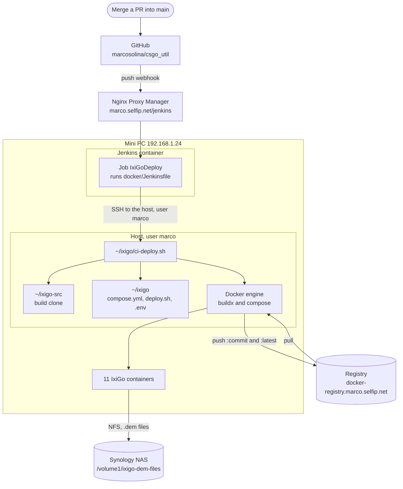
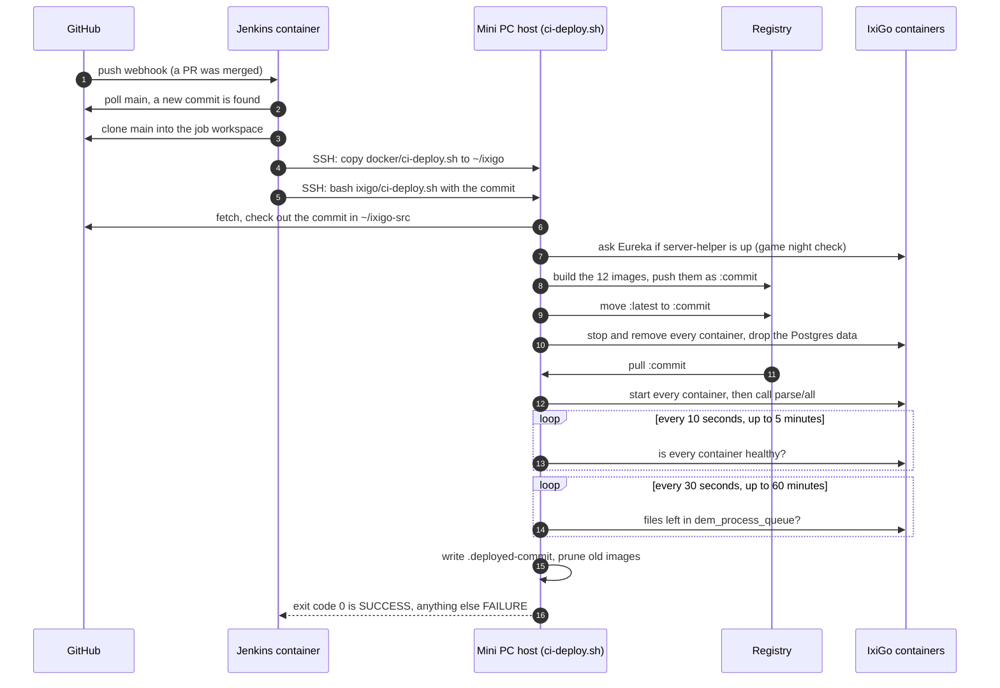
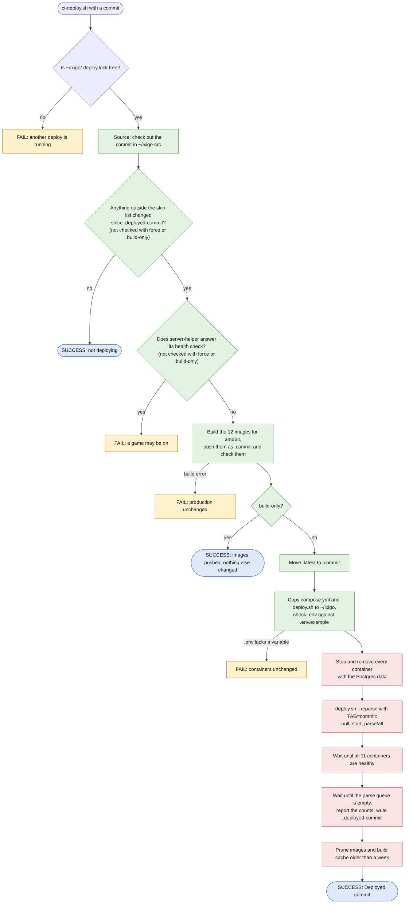

# Automatic deploy with Jenkins

Every merge into `main` is built and deployed to the mini PC by the Jenkins job `IxiGoDeploy`, with no manual step. The job builds the images, pushes them to the registry, replaces every container with a new one (the database starts empty) and waits until dem-manager has rebuilt the stats from the `.dem` files. A deploy takes about 30 minutes, almost all of it the reparse, and the stats are incomplete until it ends.

## The pieces and where they run



Jenkins builds nothing itself: its container has no Docker. Each build connects over SSH from the Jenkins container to the host it runs on, and a script there does the work with the host's Docker. Jenkins therefore needs nothing but an SSH key, the build cache stays on the host between builds, the Jenkins container gets no control over the host's Docker, and the same script can be run by hand.

## Files and locations

In this repository:

| File | Used from | What it is |
| --- | --- | --- |
| `docker/Jenkinsfile` | Read by Jenkins from `main` at the start of each build | The pipeline: trigger, parameters and the two SSH calls. No deploy logic. |
| `docker/ci-deploy.sh` | Copied by each build to `~/ixigo/ci-deploy.sh` on the mini PC and run there | All the deploy logic, see [Steps](#steps-of-ci-deploysh). Can also be run by hand. |
| `docker/compose.build.yml`, `docker/Dockerfile` | `~/ixigo-src/docker` on the mini PC | How the 12 images are built. |
| `docker/compose.yml`, `docker/deploy.sh` | Copied to `~/ixigo` by `ci-deploy.sh` | How the 11 containers run, and the pull, restart and reparse script. |
| `docker/.env.example` | Compared with `~/ixigo/.env` | The settings every host's `.env` must have. |

On the mini PC (`marco@192.168.1.24`):

| Path | What it is |
| --- | --- |
| `~/jenkins` | The Jenkins container: `docker-compose.yml` and `Dockerfile` from Marco's `docker` repository (folder `jenkins/`), data in `~/jenkins/jenkins_home` (`/var/jenkins_home` inside the container). |
| `~/jenkins/jenkins_home/jobs/IxiGoDeploy/config.xml` | The job: "Pipeline script from SCM", this repository, branch `*/main`, script path `docker/Jenkinsfile`, GitHub push trigger. Everything else comes from the Jenkinsfile. |
| `~/jenkins/jenkins_home/.ssh/` | The SSH key the jobs use (the Azure VM job too) and `known_hosts` with the mini PC host key pinned. |
| `~/.ssh/authorized_keys` | The Jenkins public key, limited with `from="172.16.0.0/12"`: accepted only from Docker containers on the mini PC, refused from the LAN. |
| `~/ixigo-src` | The build clone of this repository. Each deploy checks out its commit (detached) and removes untracked files. |
| `~/ixigo` | The running stack: `compose.yml`, `deploy.sh`, `.env` (secrets, never in git, never overwritten), `ci-deploy.sh`, `.deployed-commit` (the last commit deployed successfully) and `.deploy.lock`. |

Images go to `docker-registry.marco.selfip.net/ixigo/<image>` with two tags: the short commit (8 characters, for example `:0f3b822d`) and `:latest`.

## What happens on a merge



- The webhook reaches Jenkins through Nginx Proxy Manager at `https://marco.selfip.net/jenkins/github-webhook/`. GitHub sends it for every push to the repository; Jenkins then checks `main` and starts a build only when `main` has a commit it has not built yet, so pushes to other branches do nothing.
- One build runs at a time: a merge during a deploy waits in the queue, and that build deploys everything merged until it starts.
- The Jenkinsfile has one stage, "Build and deploy on the mini PC". Before it, Jenkins runs its own "Declarative: Checkout SCM" stage, which clones `main` into the job workspace (`/var/jenkins_home/workspace/IxiGoDeploy`); the `ci-deploy.sh` that gets copied comes from there.

## Steps of ci-deploy.sh



Green steps leave the running stack as it is, so a failure there changes nothing for the users. From the first red step on, the containers are being replaced: a failure there leaves the stack down or partly parsed until the job is rerun, a fix is merged, or an older commit is deployed. Yellow boxes are the failures, blue ones the successful endings.

Each step prints a line `=== hh:mm:ss <step>` in the Jenkins console. That time is the mini PC's local time; the timestamps Jenkins adds in brackets are UTC.

| Step in the log | What it does | When it fails |
| --- | --- | --- |
| `Source: <commit>` | Fetches this repository in `~/ixigo-src`, checks out the commit and prints it. Then, without a line of its own, compares it with `~/ixigo/.deployed-commit`: if every changed file is on the skip list, it prints them and "Not deploying", and the build ends with SUCCESS. Skip list: `*.md`, `docs/`, `legacy/`, `tools/`, `plugins/` (the plugin is built on the Azure VM), `docker/test/`, `docker/Jenkinsfile`, `docker/ci-deploy.sh`, `docker/build-and-push.ps1`. | A `COMMIT` that does not exist. |
| `Game night check` | Asks Eureka for `IXIGO-SERVER-HELPER`. If an instance answers its health check, the Azure VM is up and a game may be on. | The build fails before anything is touched. Rerun it after the game, or use `FORCE`. |
| `Build and push the images as :<commit> (amd64)` | `docker buildx bake -f compose.build.yml --push` from `~/ixigo-src/docker`, amd64 only; checks that every image is in the registry, then moves `:latest` to the new images (no rebuild). About 1.5 minutes from the cache, 3 minutes from an empty one. | Production is unchanged. Fix it with a new PR. |
| `Update the deploy files in /home/marco/ixigo` | Copies `compose.yml` and `deploy.sh` into `~/ixigo` and checks that `.env` has every variable of `docker/.env.example`. | Add the missing variable to `~/ixigo/.env` by hand and rerun. `:latest` already points at the new images, but the containers still run the old ones. |
| `Stop every container and drop the Postgres data` | `docker compose rm --stop --force --volumes`: removes the containers and their anonymous volumes, which hold the Postgres data. The named `demfiles` volume (the `.dem` files on the NAS) is never removed. | |
| `Start :<commit> and re-parse the .dem files` | `TAG=<commit> sh deploy.sh --reparse`: pulls, starts every container (Postgres runs the seed SQL on its empty data folder), then the `reparse` service waits for dem-manager and calls `parse/all`. | |
| `Wait until every container is healthy` | Polls `docker compose ps` every 10 seconds, up to 5 minutes. | Names the containers that are not healthy. Check `docker compose logs <service>` in `~/ixigo`. |
| `Wait for dem-manager to parse every .dem file` | Polls `dem_process_queue` every 30 seconds (a progress line every 2 minutes), up to 60 minutes. Then prints the parsed, failed, match and duplicate counts and writes `.deployed-commit`. About 25 minutes for 1,443 files. 23 of them fail to parse today: that is known and does not fail the build. | Files still queued after 60 minutes, or a `.dem` file saved as more than one match. |
| `Prune images and build cache older than a week` | `docker image prune -af` and `docker builder prune -f`, both with `until=168h`. Never volumes. | |
| `Deployed <commit>` | The end: the build is SUCCESS. | |

The whole build has a 90-minute timeout.

## Build with Parameters

The job page in Jenkins has "Build with Parameters" for the cases the automatic trigger does not cover:

| Parameter | Effect |
| --- | --- |
| `COMMIT` | Deploys this commit instead of the head of `main`. Empty means the head of `main`. |
| `FORCE` | Skips the skip check and the game night check. |
| `BUILD_ONLY` | Builds and pushes `:<commit>` only: `:latest` and the running stack stay as they are. |

- **Roll back:** `COMMIT` set to the last good commit. Its images are rebuilt (mostly from the cache), `:latest` moves back, and the database is rebuilt with that commit's seed SQL. The script that runs is still the one on `main`, so it works for any commit that already has `docker/compose.build.yml`. The next merge into `main` deploys `main` again.
- **Redeploy what is already deployed** (a fresh database, for example): `FORCE`, otherwise the skip check finds no change.
- **Check that a commit builds** without deploying it: `BUILD_ONLY`.
- **Deploy during a game:** `FORCE`. It restarts the Discord bot and empties the stats in the middle of the game.

To stop automatic deploys for a while, disable the job (job page, "Disable Project") and enable it again later.

## Running it by hand on the mini PC

```bash
ssh marco@192.168.1.24
bash ~/ixigo/ci-deploy.sh                          # deploy origin/main
bash ~/ixigo/ci-deploy.sh 7952745c                 # deploy, or roll back to, a commit
bash ~/ixigo/ci-deploy.sh --build-only 7952745c    # build and push only
bash ~/ixigo/ci-deploy.sh --force                  # skip the skip check and the game night check

# A deploy takes about 30 minutes: keep it running if the SSH session drops
nohup bash ~/ixigo/ci-deploy.sh > ~/ixigo/ci-deploy.log 2>&1 &
```

The lock `~/ixigo/.deploy.lock` keeps a manual run and a Jenkins build from overlapping: the second one fails at once with "another deploy is running on this host". Every Jenkins build replaces `~/ixigo/ci-deploy.sh` with the version on `main`, so copy a changed script there before trying it by hand.

## The Jenkins container

Jenkins 2.387.3 LTS (JDK 17) with Maven 3.9.9, image `jenkins-homelab:2.387.3`, defined in Marco's `docker` repository (folder `jenkins/`) and run with `docker compose up -d` from `~/jenkins` on the mini PC. It listens on port 8080 with the path `/jenkins`, published by Nginx Proxy Manager at `https://marco.selfip.net/jenkins`. Besides `IxiGoDeploy` it runs `IxiDeployVm` (started remotely by the Azure pipeline that creates the game server VM), `Java Utils` and `TapoCSharp`. It moved there from the BuildServer VM on 2026-11-17.
